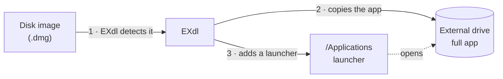

<div align="center">


# EXdl

**Install Mac apps straight onto an external drive —<br>and keep them in Launchpad and Spotlight.**

<br>

[](#requirements)
[](#requirements)
[](#install)
[](Package.swift)

[**Download**](https://github.com/erdembeler/exdl/releases/latest) &nbsp;·&nbsp; [How it works](#how-it-works) &nbsp;·&nbsp; [Build from source](#build-from-source)

</div>

<br>

EXdl (External Download & Install) is a menu bar utility that makes an external SSD a first-class home for your apps. Open a disk image, drop the app on your drive, and EXdl takes care of the rest.

## Why EXdl

A Mac's internal storage can't be upgraded, and large apps — Xcode, Docker, Unreal Engine, Blender, games — fill it quickly. An external SSD solves the capacity problem, but macOS isn't designed to install apps onto it.

| | Without EXdl | With EXdl |
| :-- | :-- | :-- |
| **Installing from a disk image** | The *Applications* shortcut always points to the internal disk | Drop the app straight onto your external drive |
| **Launchpad & Spotlight** | Symlinked apps often don't show up | Apps stay searchable and launchable |
| **Drive disconnected** | The app silently fails to open | A clear prompt asks you to reconnect the drive |
| **Auto-updates** | The updater writes a new copy to the internal disk | EXdl detects it and offers to move it back |

## How it works



EXdl doesn't rely on symbolic links. For every app it installs, it places a small launcher bundle in `/Applications` that carries the original icon and metadata, so Launchpad, Spotlight and the Dock treat it like any other app. Opening it starts the real app from your drive — or asks you to reconnect the drive if it isn't available.

## Features

- **Automatic** — reacts when a disk image is mounted or an app lands in `/Applications`, and ejects the image once the install is done.
- **Update protection** — if an updater replaces the launcher with a full copy, EXdl moves the new version back to the drive, on your confirmation or automatically.
- **Storage dashboard** — see what lives where and move apps between the internal and external disk.
- **Quiet and private** — runs from the menu bar, can launch at login, ignores apps below a size you choose, and makes no network requests.

## Install

1. Download the latest `EXdl-<version>.dmg` from the [Releases](https://github.com/erdembeler/exdl/releases/latest) page.
2. Open it and drag **EXdl** into **Applications**.
3. Launch EXdl — it lives in the menu bar — and choose your external drive.
4. Grant **Full Disk Access** under *System Settings → Privacy & Security* so EXdl can manage apps in `/Applications`. Without it, EXdl may ask for an administrator password.

EXdl is signed with a Developer ID certificate and notarized by Apple.

## Requirements

- macOS 14 Sonoma or later
- Apple Silicon Mac
- An external drive formatted as APFS or Mac OS Extended
- The interface is currently available in Turkish only

## Build from source

```bash
git clone https://github.com/erdembeler/exdl.git
cd exdl

./build_app.sh        # build EXdl.app
./package_release.sh  # build and package dist/EXdl-<version>.dmg and .zip
./notarize.sh         # sign with Developer ID and notarize the release DMG
```

`notarize.sh` needs a *Developer ID Application* certificate and a `notarytool` keychain profile; set `TEAM_ID` and `KEYCHAIN_PROFILE` at the top of the script. The installer image is built with [dmgbuild](https://github.com/dmgbuild/dmgbuild), which the scripts install into `.build/` on first run (Python 3 and network access required).

## License

Released under the MIT License.
