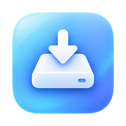
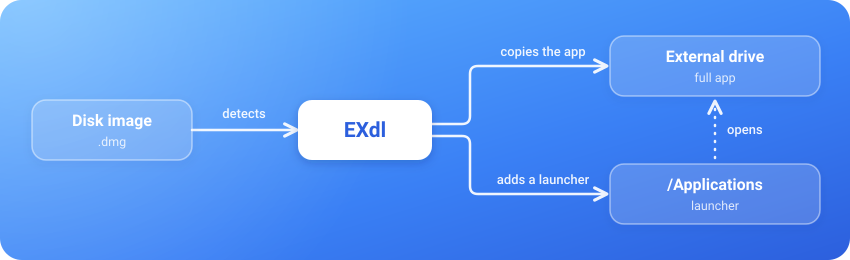

<div align="center">

<p align="center">
  <a href="README.md">English</a> ·
  <a href="README_TR.md">Türkçe</a> ·
  <a href="README_JA.md">日本語</a> ·
  <strong>简体中文</strong> ·
  <a href="README_ES.md">Español</a>
</p>



# EXdl
### macOS 外置驱动器应用安装与存储管理工具

**直接将 Mac 应用安装至外置固态硬盘，同时完整保留启动台 (Launchpad) 与聚焦搜索 (Spotlight) 体验。**

<br>

[](#系统要求)
[](#系统要求)
[](https://github.com/erdembeler/exdl/releases/latest)
[](#安装方法)
[](Package.swift)
[](LICENSE)

[**下载最新发行版**](https://github.com/erdembeler/exdl/releases/latest) &nbsp;·&nbsp; [工作原理](#工作原理) &nbsp;·&nbsp; [所需权限说明](#权限说明与原由) &nbsp;·&nbsp; [从源码构建](#从源码构建)

</div>

<br>

EXdl 是一款原生轻量级的 macOS 菜单栏应用，让外置移动固态硬盘（SSD）成为应用的稳定安装存储介质，同时无缝融入 macOS 原生系统体验。

---

## 解决的痛点

Mac 的内置固态硬盘无法后期升级。开发环境、3D 渲染套件、游戏引擎以及各类大型游戏会迅速占满昂贵的内置存储空间。

通常从网络下载 `.dmg` 安装镜像时，macOS 的拖拽窗口仅支持将应用拖入内置磁盘的 `/Applications` 文件夹。如果用户手动将其拖到外置硬盘并创建别名或符号链接（Symlink），往往会面临以下难题：
- macOS 启动台（Launchpad）、聚焦搜索（Spotlight）以及 macOS Sequoia 的“应用程序”视图经常无法建立符号链接索引，导致应用无法搜到或无法列出。
- 当外置硬盘未连接时点击链接，系统往往静默失败退出或弹出难以理解的底层错误。
- 当应用进行自动更新时，更新程序会直接覆盖符号链接，将完整应用重新写入内置固态硬盘，在不知不觉中再次吃满内置空间。

---

## 工作原理

<p align="center">
  
</p>

EXdl 摒弃了脆弱的传统符号链接，采用独创的**智能应用启动桩（Smart App Stub）**方案：
1. 当你打开 `.dmg` 磁盘镜像时，EXdl 会自动感知并弹出原生安装窗口，直接引导安装到外置硬盘。
2. 完整的应用程序包安全存放于你的外置移动硬盘中。
3. 在内置 `/Applications` 目录下，EXdl 会生成一个仅约 500 KB 的原生应用启动桩，继承原应用的图标、Bundle ID 和元数据。
4. 启动台、聚焦搜索与程序坞（Dock）将完全视其为原生已安装应用。
5. 若外置硬盘未插上时启动该应用，EXdl 会弹出友好的连接提示，而不会让系统卡死或无响应。

---

## 主要特性

- **自动磁盘镜像识别** — 打开 `.dmg` 文件时自动接管安装，一键写入外置硬盘，安装完成后自动推出镜像。
- **更新防覆盖保护** — 应用后台更新若重写了启动桩，EXdl 能自动识别并协助将新版本重新迁移至外置存储。
- **存储面板与双向迁移** — 集中查看内外置磁盘应用占用，支持将内置应用一键迁移至外置硬盘，亦可随时无损迁回内置磁盘。
- **不兼容应用智能过滤** — 自动检测并阻止移动必须依赖根磁盘运行的应用（如 Xcode、系统开发工具链、含 macOS 驱动/系统扩展的应用、开机自启常驻后台服务等）。
- **10 款定制视网膜菜单栏图标** — 可在设置中自由切换 10 种矢量图标风格（默认采用 EX Monogram 双字母徽标）。监控开启时显示实心（Filled），暂停时显示空心（Hollow）。
- **内置 OTA 软件更新** — 基于 GitHub Releases 自动检测新版本，经代码签名校验后一键静默就地更新。
- **安静轻量且保护隐私** — 仅在菜单栏运行，极低资源占用，支持开机启动，除用户主动检查更新外绝不产生任何外部网络请求。

---

## 方案对比

| 对比维度 | macOS 原生方式 | 手动符号链接 (Symlink) | 使用 EXdl |
| :-- | :-- | :-- | :-- |
| **DMG 安装目标** | 仅限内置磁盘 | 需手动拷贝文件 | 一键直接安装至外置硬盘 |
| **启动台与聚焦搜索** | 完整支持 | 经常无法索引或丢失 | 100% 原生支持 |
| **外置硬盘未连接** | 不涉及 | 静默崩溃或无提示失败 | 弹出清晰的重新连接指引 |
| **应用自动更新** | 写入内置磁盘 | 破坏链接重新写满内置盘 | 自动恢复并迁移至外置硬盘 |
| **内置空间节省** | 0 GB | 节省空间但极不稳定 | 稳定可靠，省下数十乃至上百 GB |

---

## 权限说明与原由

为了使 EXdl 能够安全执行应用管理，macOS 需要授予以下隐私权限：

1. **应用管理 (`App Management`) — 必需**
   - **原由:** EXdl 需要在 `/Applications` 目录下创建轻量启动桩，并将应用安全移动到外置磁盘。
   - **授予方式:** 打开 *系统设置 → 隐私与安全性 → App 管理*，启用 EXdl。若列表中未出现，点击左下方 `+` 号手动添加 `/Applications/EXdl.app`。
2. **完全磁盘访问权限 (`Full Disk Access`) — 推荐**
   - **原由:** 允许 EXdl 读取“下载”文件夹中的磁盘镜像并写入外置卷宗，避免 macOS 频繁弹出重复确认弹窗。
   - **授予方式:** 打开 *系统设置 → 隐私与安全性 → 完全磁盘访问权限*，启用 EXdl。

---

## 安装方法

1. 前往 [GitHub Releases](https://github.com/erdembeler/exdl/releases/latest) 页面下载最新安装包（`EXdl-1.1.0.dmg` 或 `EXdl-1.1.0.zip`）。
2. 打开 DMG 镜像并将 **EXdl** 拖入 **Applications** 文件夹。
3. 启动 EXdl，初次配置向导将协助你完成语言切换、外置安装目录选择与权限开启。
4. 完成后，EXdl 将常驻在菜单栏右上角静候使用。

所有发布的安装包均已由官方 Apple Developer ID 进行数字代码签名并获得苹果官方公证（Notarized）。

---

## 系统要求

- macOS 14 Sonoma 或更高版本
- Apple Silicon 系列芯片 Mac (M1 / M2 / M3 / M4)
- 格式化为 **APFS**（推荐）或 **Mac OS 扩展（日志式）** 的外置存储设备

---

## 从源码构建

```bash
git clone https://github.com/erdembeler/exdl.git
cd exdl

# 构建应用程序包
./build_app.sh

# 打包 DMG 与 ZIP 发行文件
./package_release.sh
```

---

## 开源协议

本项目采用 [MIT 许可证](LICENSE) 开源发布。
